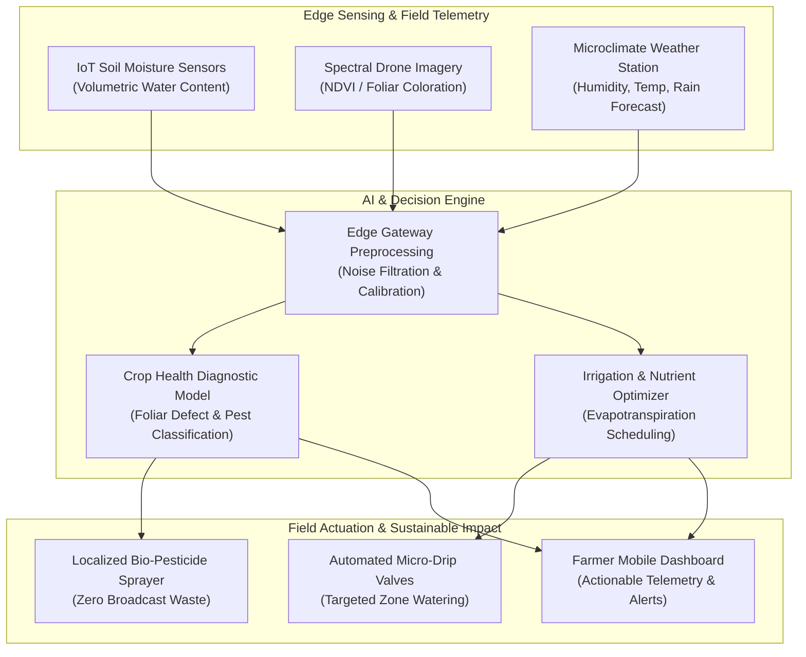

<div align="center">

<a href="https://github.com/akashvenkey/Artificial-intelligence">

</a>


### 🔗 **Project Source Link:** [https://github.com/akashvenkey/Artificial-intelligence](https://github.com/akashvenkey/Artificial-intelligence)

[](https://github.com/akashvenkey/Artificial-intelligence)
[](https://github.com/akashvenkey/Artificial-intelligence.git)

[](https://github.com/akashvenkey/Artificial-intelligence)
[](https://github.com/akashvenkey/Artificial-intelligence)
[](https://www.alliance.edu.in/)
[-4F46E5?style=for-the-badge)](#)
[](#)

</div>

---

## 📌 Executive Summary & Overview

Modern industrial agriculture faces a dual crisis: accelerating global food demands juxtaposed against severe environmental degradation caused by chemical runoff, soil depletion, groundwater overextraction, and ecological imbalance. Conventional agricultural workflows often rely on uniform, schedule-based pesticide spraying and flood irrigation, resulting in significant resource wastage and downstream contamination.

The **Sustainable Agri AI** repository presents a comprehensive technical research project submitted for the Bachelor of Computer Applications (Honors) degree at **Alliance University**. It investigates how **Artificial Intelligence**, **IoT field telemetry**, **computer vision**, and **predictive machine learning** can converge to engineer sustainable agricultural ecosystems. The research explores precision farming paradigms that optimize irrigation schedules, detect early crop pathogens, minimize synthetic agrochemical inputs, and protect natural biodiversity while maintaining high agricultural productivity.

---

## 📑 Interactive Table of Contents

- [📌 Executive Summary & Overview](#-executive-summary--overview)
- [✨ Key Features & Research Highlights](#-key-features--research-highlights)
- [🌱 Core Sustainable Agriculture Pillars](#-core-sustainable-agriculture-pillars)
- [🏗 System Architecture & Smart Farm Pipeline](#-system-architecture--smart-farm-pipeline)
- [🛠 Tech Stack & Analytical Breakdown](#-tech-stack--analytical-breakdown)
- [🚀 Reproducible Setup & Document Navigation](#-reproducible-setup--document-navigation)
- [📂 Project Directory Layout](#-project-directory-layout)
- [👨‍💻 Author & Contributions](#-author--contributions)

---

## ✨ Key Features & Research Highlights

- **🌾 Precision Resource Allocation:** Algorithmic optimization of water and nutrient delivery based on real-time soil moisture sensors, ambient temperature, and evapotranspiration calculations.
- **🔬 Computer Vision for Pathogen Detection:** Architectural workflows utilizing convolutional neural networks (CNNs) to identify early foliar diseases, pest infestations, and nutrient deficiencies.
- **💧 Smart Irrigation Telemetry:** Closed-loop automated drip systems that reduce groundwater depletion by up to 40% compared to conventional furrow irrigation methods.
- **🌍 Soil Health & Carbon Sequestration:** Analytical review of regenerative agricultural techniques, such as cover cropping, biochar enrichment, and automated minimum-tillage scheduling.
- **📋 Policy & Government Initiatives:** Comparative synthesis of global and Indian agricultural modernization frameworks (such as Paramparagat Krishi Vikas Yojana and digital public agritech infrastructure).

---

## 🌱 Core Sustainable Agriculture Pillars

```plaintext
┌─────────────────────────────────────────────────────────────────────────────┐
│                       SUSTAINABLE AGRI AI ECOSYSTEM                         │
├──────────────────────┬──────────────────────┬───────────────────────────────┤
│ Ecological Balance   │ Economic Feasibility │ Technological Innovation      │
├──────────────────────┼──────────────────────┼───────────────────────────────┤
│ • Zero chemical run- │ • Input cost reduc-  │ • AI computer vision drone    │
│   off into aquifers  │   tion via precision │   scouting for pest zones     │
│ • Soil microbiome    │   fertilization      │ • IoT capacitive soil sensors │
│   preservation       │ • High crop yield    │ • Predictive weather and frost│
│ • Natural pollinator │   stability across   │   warning models              │
│   protection         │   seasonal cycles    │ • Automated drip micro-valves │
└──────────────────────┴──────────────────────┴───────────────────────────────┘
```

---

## 🏗 System Architecture & Smart Farm Pipeline

The following architectural flowchart demonstrates how sensor data, machine learning models, and automated field hardware interact in a precision farming loop:



---

## 🛠 Tech Stack & Analytical Breakdown

| Layer | Focus Area | Functional Role |
| :--- | :--- | :--- |
| **Domain** | Precision Agriculture & AgTech | Sustainable farming, soil preservation, and crop life-cycle monitoring |
| **AI / ML Focus** | Computer Vision & Predictive Models | Pest diagnosis, chlorophyll index evaluation, and yield estimation |
| **Telemetry / IoT** | Sensor Network Architecture | Soil capacitance probes, ambient climate telemetry, and edge gateways |
| **Methodology** | Academic Research & Systems Design | Quantitative literature review, field architecture synthesis, and comparative analysis |
| **Documentation** | Microsoft Word & Presentation Suite | Complete research monograph, index, references, and defense presentation |

---

## 🚀 Reproducible Setup & Document Navigation

### Accessing the Research Project
The complete project documentation and accompanying presentations are encapsulated within the repository.

```bash
# 1. Clone this repository
git clone https://github.com/akashvenkey/Artificial-intelligence.git

# 2. Navigate into the repository directory
cd Artificial-intelligence

# 3. View the project report in Microsoft Word or compatible viewer
start "Sustainability Agriculture Project Report And Ppt.docx"
```

### Document Contents Index
1. **Introduction & Motivation:** Global resource depletion and imperatives for sustainable agronomy.
2. **Taxonomy of Eco-Farming:** Organic farming, agroforestry, crop rotation, and permaculture.
3. **Technological Infrastructure:** Drone remote sensing, automated drip grids, and AI predictive algorithms.
4. **Empirical Case Studies:** Real-world implementations demonstrating water conservation and yield stability.
5. **Government Policy & Roadmap:** Strategic integration of national digital agriculture platforms.

---

## 📂 Project Directory Layout

```plaintext
Artificial-intelligence/
├── Sustainability Agriculture Project Report And Ppt.docx # Complete research report and presentation deck
└── README.md                                             # Comprehensive architectural specification and research overview
```

---

## 👨‍💻 Author & Contributions

**Akash V**  
- **GitHub:** [@akashvenkey](https://github.com/akashvenkey)  
- **Program:** Bachelor of Computer Applications (Hons)  
- **Department:** Department of Computer Application, Alliance University, Bengaluru  
- **Student ID / Reg No:** `2411021240010`  

Collaborations on precision agriculture, AgTech data systems, and environmental computing are encouraged. If this research framework is helpful, please consider leaving a ⭐!

---

<div align="center">

<a href="https://github.com/akashvenkey/Artificial-intelligence">

</a>


### 🔗 **Project Source Link:** [https://github.com/akashvenkey/Artificial-intelligence](https://github.com/akashvenkey/Artificial-intelligence)

[](https://github.com/akashvenkey/Artificial-intelligence)
[](https://github.com/akashvenkey/Artificial-intelligence.git)

</div>